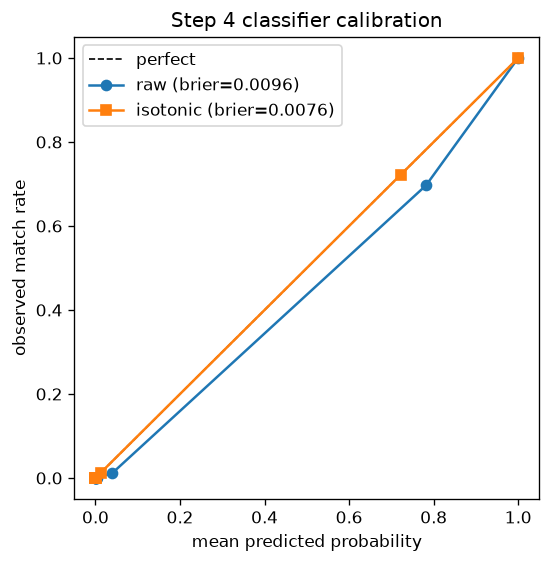

# Step 4 gate report

890,700 candidate pairs, positive rate 0.1709, 5 grouped folds.

## Metrics (out-of-fold, threshold 0.5)

| slice | AUC | PR-AUC | macro F0.5 | n pairs | pos rate |
|---|---|---|---|---|---|
| overall | 0.9989 | 0.9953 | 0.9633 | 890,700 | 0.1709 |
| India | 0.9985 | 0.9938 | 0.9545 | 353,360 | 0.1701 |
| US | 0.9991 | 0.9962 | 0.9690 | 537,340 | 0.1715 |

## Calibration

raw max gap 0.0852, brier 0.0096; isotonic calibration applied.

## Country-holdout check (leave-country-out, stand-in for France)

Holdout country: **India**

| | AUC | PR-AUC | macro F0.5 |
|---|---|---|---|
| in-distribution (in CV) | 0.9985 | 0.9938 | 0.9545 |
| leave-country-out | 0.9930 | 0.9746 | 0.8323 |

holdout-country macro F0.5 gap: **0.1222** (in-distribution − leave-country-out)

## Feature importance (mean gain across folds)

| rank | feature | gain |
|---|---|---|
| 1 | p | 8635881.6 |
| 2 | margin_to_best_competitor | 845386.1 |
| 3 | name_tok_extra_t_idf | 342770.9 |
| 4 | addr_num_jaccard | 285471.4 |
| 5 | n_channels | 228182.1 |
| 6 | house_abs_diff | 149428.6 |
| 7 | name_tok_extra_t_n | 126941.3 |
| 8 | score_B5_name_addr | 86274.1 |
| 9 | sim_full_tset | 80335.4 |
| 10 | sim_name_jw | 76686.6 |
| 11 | name_tok_overlap_idf | 69787.6 |
| 12 | addr_tok_overlap_idf | 51370.5 |
| 13 | name_tok_extra_q_idf | 50804.2 |
| 14 | score_B1_name_concat | 48781.1 |
| 15 | rank_B5_name_addr | 47788.1 |
| 16 | sim_name_partial | 47604.2 |
| 17 | legal_relation | 46746.6 |
| 18 | house_rel_diff | 43867.2 |
| 19 | sim_name_char3 | 43258.7 |
| 20 | addr_tok_extra_t_idf | 35525.9 |
| 21 | addr_tok_extra_q_idf | 33259.6 |
| 22 | sim_name_ratio | 33033.0 |
| 23 | rank_within_s1_src | 30217.0 |
| 24 | rank_B4_addr_char | 28630.1 |
| 25 | addr_tok_extra_t_n | 25326.4 |

